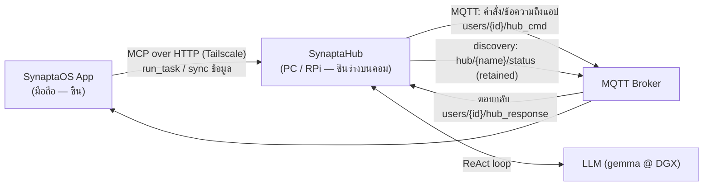

# SynaptaHub

สมองฝั่งบ้านของ [SynaptaOS](https://github.com/Ninlapat5G/SynaptaOS-App) — รันบน PC / Mac / Raspberry Pi
แล้วเปิดให้ "ซิน" (ผู้ช่วย AI ในแอป) สั่งงานเครื่องนี้ผ่านภาษาคน + ดูแลผู้ใช้ได้หลายคน

---

## ภาพรวม



- **App → Hub**: ผ่าน **MCP over HTTP** บนวง Tailscale (เข้ารหัส WireGuard) — แอปเรียก `run_task`, sync โปรไฟล์/อุปกรณ์ ฯลฯ
- **Hub → App**: ผ่าน **MQTT** — Hub ส่งคำสั่ง/ข้อความไปแอป แล้วรอผลกลับ
- **Discovery**: Hub broadcast ที่อยู่ (Tailscale IP + พอร์ต) ขึ้น MQTT แบบ retained ให้แอปเจอเอง

---

## โครงสร้างไฟล์

```
SynaptaOS-Hub/
├── src/                 โค้ดที่รันจริงทั้งหมด
│   ├── main.py          entry point (discovery + MCP server)
│   ├── config.py        อ่านค่าทั้งหมดจาก .env
│   ├── agent.py         สมอง ReAct ของ Hub (รู้จักผู้ใช้หลายคน)
│   ├── server.py        FastMCP server (App ต่อเข้ามา)
│   ├── webadmin.py      หน้าเว็บผู้ดูแล /admin + API
│   ├── discovery.py     broadcast ที่อยู่ผ่าน MQTT
│   ├── store.py         เก็บข้อมูลผู้ใช้ (แยกไฟล์ แยกคน)
│   ├── osprofile.py     คำสั่งเฉพาะ OS (win/mac/linux)
│   ├── tools/           เครื่องมือ MCP (os_exec, iot, account, ...)
│   ├── web/             หน้าเว็บผู้ดูแล (React + Tailwind)
│   ├── data/            ข้อมูลผู้ใช้ (gitignored)
│   └── .env             ตั้งค่า (gitignored)
├── packaging/           build_gui.py — คอมไพล์เป็น .exe
├── docs/                บันทึก/แผน
└── requirements.txt
```

---

## ติดตั้งและรัน

```bash
git clone https://github.com/Ninlapat5G/SynaptaOS-Hub.git
cd SynaptaOS-Hub
pip install -r requirements.txt
cp src/.env.example src/.env        # แล้วแก้ค่าใน src/.env

python src/main.py
```

พอรัน `main.py` จะทำ 2 อย่าง: broadcast ที่อยู่ (discovery) + เปิด MCP server + หน้าเว็บผู้ดูแล

### ค่าใน `src/.env` ที่สำคัญ

```env
LLM_BASE_URL=http://dgx:11434/v1     # สมอง LLM (Ollama /v1)
LLM_MODEL=gemma4:26b

MCP_PORT=8765                        # พอร์ตที่ App + หน้าเว็บใช้
MCP_TOKEN=                           # รหัสกันแอปแปลกในวง (ว่าง = ไม่เช็ค)
ADMIN_TOKEN=                         # รหัสหน้าเว็บผู้ดูแล (ว่าง = เข้าได้เลย)

MQTT_BROKER=broker.hivemq.com
MQTT_PORT=8883
MQTT_USE_TLS=true
MQTT_BASE_TOPIC=Mylab/smarthome      # ตั้งให้เฉพาะตัว กันชนกับคนอื่นบน broker สาธารณะ
AGENT_NAME=office-pc                 # ชื่อ Hub ที่โชว์ในแอป
```

---

## หน้าเว็บผู้ดูแล

เปิด **`http://<Tailscale-IP>:8765/admin`** (React + Tailwind, responsive)

- **ผู้ใช้งาน** — ดู/ตรวจข้อมูลผู้ใช้ที่จับคู่ (โปรไฟล์ / อุปกรณ์ / ฉาก / รูทีน / มือถือ)
- **เอเจนต์** — พิมพ์สั่งซินทำงานได้เลย เลือก *โฟกัสที่ผู้ใช้* คนใดคนหนึ่ง หรือปล่อย *อัตโนมัติ* ให้ซินเลือกคนเองจากคำสั่ง
- **ระบบหลังบ้าน** — สถานะเครื่อง + รายการเครื่องมือ (MCP tools)
- **ความปลอดภัย** — ตั้ง `ADMIN_TOKEN` / `MCP_TOKEN` (เขียนลง .env ให้ ไม่ต้องรีสตาร์ท)

---

## เครื่องมือของเอเจนต์

| Tool | ทำอะไร |
|------|--------|
| `os_exec` | รันคำสั่ง shell บนเครื่องนี้ |
| `web_search` | ค้นข้อมูลจากเว็บ (Serper API) |
| `query_system` | ดูสถานะเครื่องสด (RAM, disk, OS) |
| `list_users` | ดูรายชื่อผู้ใช้ทั้งหมดที่จับคู่ |
| `find_user` | ค้น + อ่านตัวตนของผู้ใช้คนหนึ่ง (จากชื่อ) |
| `read_user_data` | อ่านอุปกรณ์/ฉาก/รูทีน/มือถือ ของผู้ใช้คนหนึ่ง |
| `send_command_to_user_app` | คุย/สั่งงานแอปมือถือของผู้ใช้ แล้วรอผลกลับ |

> **หลายผู้ใช้**: เลือกโฟกัสคนใดคนหนึ่ง = สั่งงานในบริบทของคนนั้น · ไม่เลือก = ซินดูจากคำสั่งเองว่าหมายถึงใคร แล้วใช้ `find_user` / `read_user_data` ให้ถูกคน

เพิ่ม tool ใหม่: สร้าง `src/tools/<name>.py` (มีฟังก์ชัน `register(mcp)`) แล้วเติมชื่อใน `src/server.py`

---

## Build เป็น .exe (Windows)

```bash
pip install -r packaging/requirements_builder.txt
python packaging/build_gui.py
```

GUI ขึ้นมาให้กรอก settings → กด Build → ได้ `dist/SynaptaHubAgent.exe`

---

## License

Copyright (c) 2026 Ninlapat5G. All Rights Reserved. เปิดให้ดูโค้ดเท่านั้น ไม่ใช่ open source ห้ามนำไปใช้ ดัดแปลง หรือแจกจ่ายต่อโดยไม่ได้รับอนุญาตเป็นลายลักษณ์อักษร ดู [LICENSE](LICENSE)
